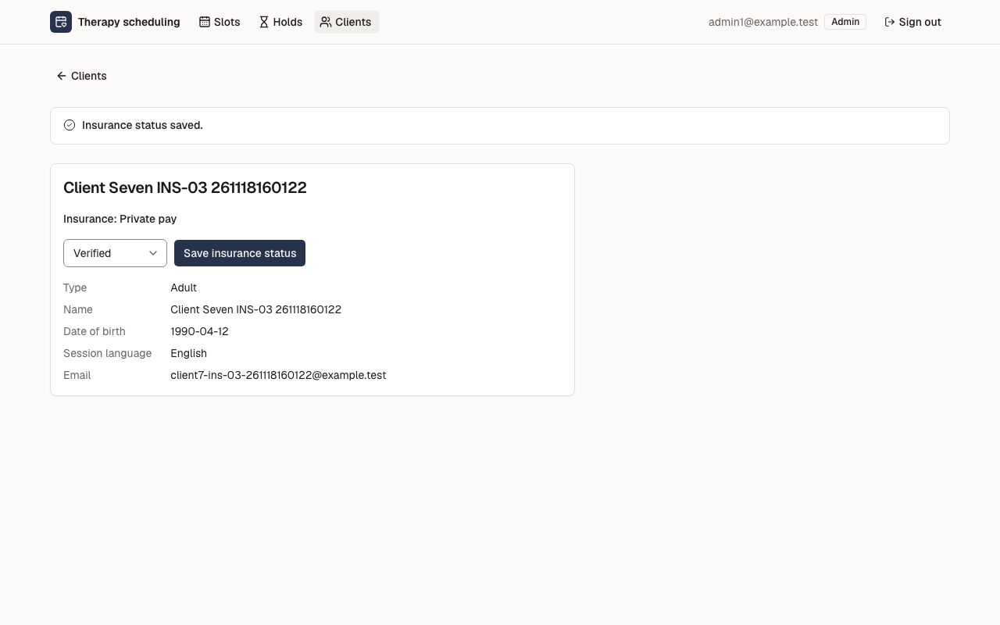
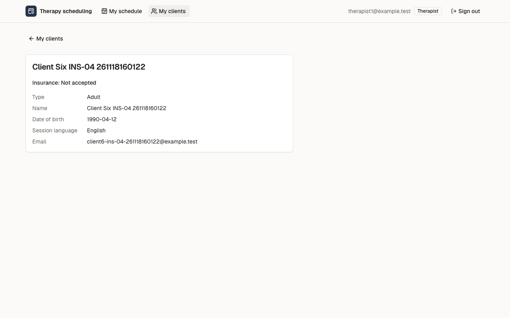
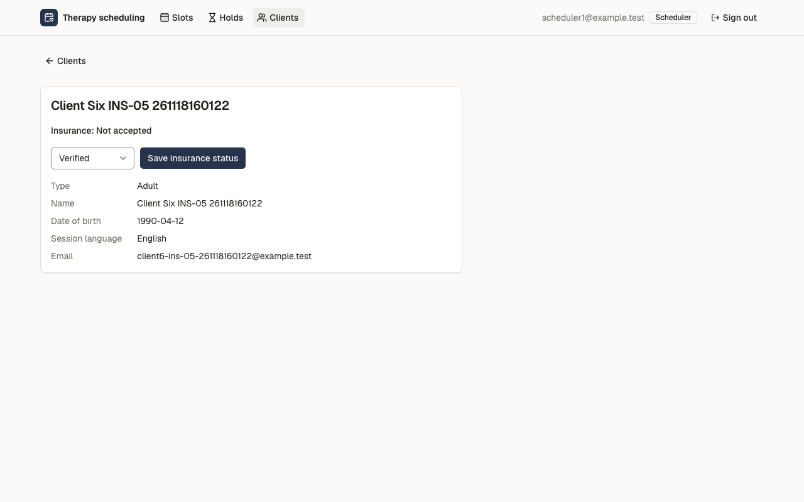
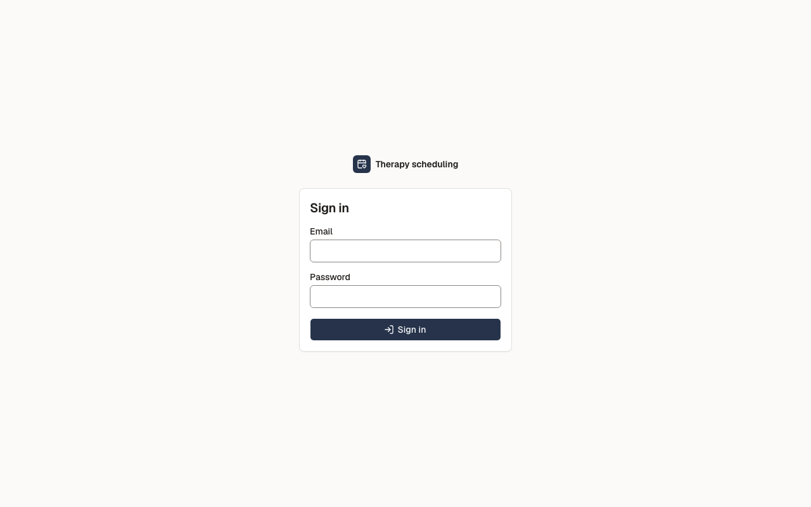

# Звіт UAT — 18.11.2026

- **Застосунок:** https://therapy-scheduling-twin-mq-factory.vercel.app (/api/health: коміт `db7c95d`)
- **Код тестів:** `uat-insurance` @ `1b63a87`
- **Прогін:** 18.11.2026, 18:01 (Київ), Playwright 76.2 с; AC: 6 — PASS 6, FAIL 0, NEEDS-HUMAN 0
- **Рецензент:** `claude-haiku-5-5`; суперечки → `claude-sonnet-5-5`. Разом за розбір: $0.0139 (ціни API; за підпискою — у межах ліміту плану)
- **Прибирання:** синтетичних uat-*@example.test видалено 0, лишилось 0, їхніх рядків, що лишились: 0
- **Відео й траси:** не в git — `test-results/` локально або артефакт CI; трасу відкриває `npx playwright show-trace <trace.zip>`

| AC | Перевірки | Агент | Підсумок | Чому | Playwright | Розбір |
|---|---|---|---|---|---|---|
| AC-INS-01 | пройшли | Haiku: PASS | **PASS** | R6: перевірки, агент і цитати збігаються | 6.3 с | $0.0022, 7.1 с |
| AC-INS-02 | пройшли | Haiku: PASS | **PASS** | R6: перевірки, агент і цитати збігаються | 8.8 с | $0.0027, 8.7 с |
| AC-INS-03 | пройшли | Haiku: PASS | **PASS** | R6: перевірки, агент і цитати збігаються | 7.1 с | $0.0025, 10.1 с |
| AC-INS-04 | пройшли | Haiku: PASS | **PASS** | R6: перевірки, агент і цитати збігаються | 11.9 с | $0.0020, 8.3 с |
| AC-INS-05 | пройшли | Haiku: PASS | **PASS** | R6: перевірки, агент і цитати збігаються | 18.4 с | $0.0019, 7.7 с |
| AC-INS-06 | пройшли | Haiku: PASS | **PASS** | R6: перевірки, агент і цитати збігаються | 8.4 с | $0.0026, 10.1 с |

## AC-INS-01 — PASS

**Тест:** AC-INS-01: scheduler1 відкриває щойно створену картку client6 — «Insurance: Not set»

**Критерій** (requirements/33-planuvalnyk-poznachaie-status-strakhuvannia.md):

> AC-INS-01: Дано картку client6 створено, і статус перевірки страхування ще ніхто не позначав. Коли scheduler1 відкриває картку client6. Тоді в картці показано «Insurance: Not set».

**Кроки:** ✔ Дано: картку client6 створено, і статус перевірки страхування ще ніхто не позначав → ✔ Коли: scheduler1 відкриває картку client6 → ✔ Тоді: в картці показано «Insurance: Not set».

**Агент (claude-haiku-5-5, PASS):** На кадрі frame-then-1.png у картці «Client Six INS-01 261118160122» видно рядок «Insurance: Not set», що точно збігається з критерієм за словами, пунктуацією і регістром. Кадр повний, без завантаження й обрізання; інших дій чи змін у картці не видно.

**Цитати агента, звірені зі сторінкою (aria):**
- «Insurance: Not set» — є на сторінці

**Правило:** R6: перевірки, агент і цитати збігаються

**Відео:** `test-results/artifacts/insurance-scheduler1-AC-IN-96e9e-ient6-—-«Insurance-Not-set»-chromium/video.webm` · **траса:** `test-results/artifacts/insurance-scheduler1-AC-IN-96e9e-ient6-—-«Insurance-Not-set»-chromium/trace.zip` (не в git)

**Рішення PM:** ☐ приймаю · ☐ відхилення від вимог (issue «Відхилення від вимог: AC-INS-01 — …») · @login: ____

## AC-INS-02 — PASS

**Тест:** AC-INS-02: scheduler1 позначає «Verified» — «Insurance status saved.» і «Insurance: Verified», зокрема після повторного відкриття

**Критерій** (requirements/33-planuvalnyk-poznachaie-status-strakhuvannia.md):

> AC-INS-02: Дано картка client6 показує «Insurance: Not set». Коли scheduler1 позначає статус перевірки страхування «Verified». Тоді scheduler1 бачить повідомлення «Insurance status saved.», а картка client6 показує «Insurance: Verified» і після того, як scheduler1 відкриє її знову.

**Кроки:** ✔ Дано: картка client6 показує «Insurance: Not set» → ✔ Коли: scheduler1 позначає статус перевірки страхування «Verified» → ✔ Тоді: scheduler1 бачить повідомлення «Insurance status saved.», а картка client6 показує «Insurance: Verified» і після того, як scheduler1 відкриє її знову. → ✔ Тоді: scheduler1 бачить повідомлення «Insurance status saved.», а картка client6 показує «Insurance: Verified» і після того, як scheduler1 відкриє її знову.

**Агент (claude-haiku-5-5, PASS):** На кадрі frame-then-1 видно повідомлення «Insurance status saved.» і рядок «Insurance: Verified» у картці «Client Six INS-02 261118160122». На кадрі frame-then-2 картка тієї самої клієнтки відкрита знову, і рядок «Insurance: Verified» там також є. Поля «Не з кадрів» (картка цього тесту, нове завантаження сторінки) не оцінювались.

**Цитати агента, звірені зі сторінкою (aria):**
- «Insurance status saved.» — є на сторінці
- «Insurance: Verified» — є на сторінці
- «Insurance: Verified» — є на сторінці

**Правило:** R6: перевірки, агент і цитати збігаються

**Відео:** `test-results/artifacts/insurance-scheduler1-AC-IN-3132b--після-повторного-відкриття-chromium/video.webm` · **траса:** `test-results/artifacts/insurance-scheduler1-AC-IN-3132b--після-повторного-відкриття-chromium/trace.zip` (не в git)

**Рішення PM:** ☐ приймаю · ☐ відхилення від вимог (issue «Відхилення від вимог: AC-INS-02 — …») · @login: ____

## AC-INS-03 — PASS

**Тест:** AC-INS-03: admin1 змінює статус client7 з «Verified» на «Private pay» — і admin1, і scheduler2 бачать «Insurance: Private pay»

**Критерій** (requirements/33-planuvalnyk-poznachaie-status-strakhuvannia.md):

> AC-INS-03: Дано картка client7 показує «Insurance: Verified». Коли admin1 змінює статус перевірки страхування на «Private pay», а потім scheduler2 відкриває картку client7. Тоді і admin1, і scheduler2 бачать у картці «Insurance: Private pay».

**Кроки:** ✔ Дано: картка client7 показує «Insurance: Verified» → ✔ Коли: admin1 змінює статус перевірки страхування на «Private pay», а потім scheduler2 відкриває картку client7 → ✔ Тоді: і admin1, і scheduler2 бачать у картці «Insurance: Private pay». → ✔ Тоді: і admin1, і scheduler2 бачать у картці «Insurance: Private pay».

**Агент (claude-haiku-5-5, PASS):** На кадрі frame-then-1.png у картці «Client Seven INS-03 261118160122» написано «Insurance: Private pay», у шапці — admin1@example.test, зверху банер «Insurance status saved.». На кадрі frame-then-2.png у тій самій картці теж «Insurance: Private pay», у шапці — scheduler2@example.test. Обидва тексти збігаються з критерієм посимвольно.

**Цитати агента, звірені зі сторінкою (aria):**
- «Insurance: Private pay» — є на сторінці
- «Insurance: Private pay» — є на сторінці
- «scheduler2@example.test» — є на сторінці

**Правило:** R6: перевірки, агент і цитати збігаються

**Відео:** `test-results/artifacts/insurance-admin1-і-schedul-f5f44-ать-«Insurance-Private-pay»-chromium/video.webm` · **траса:** `test-results/artifacts/insurance-admin1-і-schedul-f5f44-ать-«Insurance-Private-pay»-chromium/trace.zip` (не в git)

**Рішення PM:** ☐ приймаю · ☐ відхилення від вимог (issue «Відхилення від вимог: AC-INS-03 — …») · @login: ____

## AC-INS-04 — PASS

**Тест:** AC-INS-04: therapist1 відкриває картку свого клієнта client6 — «Insurance: Not accepted», змінити статус не запропоновано

**Критерій** (requirements/33-planuvalnyk-poznachaie-status-strakhuvannia.md):

> AC-INS-04: Дано client6 — свій клієнт therapist1, і картка client6 показує «Insurance: Not accepted». Коли therapist1 відкриває картку client6. Тоді він бачить «Insurance: Not accepted», а змінити статус перевірки страхування в картці йому не запропоновано.

**Кроки:** ✔ Дано: client6 — свій клієнт therapist1, і картка client6 показує «Insurance: Not accepted» → ✔ Коли: therapist1 відкриває картку client6 → ✔ Тоді: він бачить «Insurance: Not accepted», а змінити статус перевірки страхування в картці йому не запропоновано.

**Агент (claude-haiku-5-5, PASS):** На кадрі видно картку «Client Six INS-04 261118160122» з рядком «Insurance: Not accepted» і в шапці therapist1@example.test. В основній частині сторінки немає форми, поля чи кнопки для зміни статусу страхування, але це перевіряють автоматичні перевірки, тому я цю частину не оцінював.

**Цитати агента, звірені зі сторінкою (aria):**
- «Insurance: Not accepted» — є на сторінці
- «therapist1@example.test» — є на сторінці

**Правило:** R6: перевірки, агент і цитати збігаються

**Відео:** `test-results/artifacts/insurance-therapist1-AC-IN-64e75-ити-статус-не-запропоновано-chromium/video.webm` · **траса:** `test-results/artifacts/insurance-therapist1-AC-IN-64e75-ити-статус-не-запропоновано-chromium/trace.zip` (не в git)

**Рішення PM:** ☐ приймаю · ☐ відхилення від вимог (issue «Відхилення від вимог: AC-INS-04 — …») · @login: ____

## AC-INS-05 — PASS

**Тест:** AC-INS-05: therapist1 напряму, оминаючи застосунок, пробує поставити client6 «Verified» — scheduler1 бачить «Insurance: Not accepted»

**Критерій** (requirements/33-planuvalnyk-poznachaie-status-strakhuvannia.md):

> AC-INS-05: Дано client6 — свій клієнт therapist1, і картка client6 показує «Insurance: Not accepted». Коли therapist1 напряму, оминаючи сторінки застосунку, пробує змінити статус перевірки страхування client6 на «Verified». Тоді статус не змінився: scheduler1 у картці client6 бачить «Insurance: Not accepted».

**Кроки:** ✔ Дано: client6 — свій клієнт therapist1, і картка client6 показує «Insurance: Not accepted» → ✔ Коли: therapist1 напряму, оминаючи сторінки застосунку, пробує змінити статус перевірки страхування client6 на «Verified» → ✔ Тоді: статус не змінився: scheduler1 у картці client6 бачить «Insurance: Not accepted».

**Агент (claude-haiku-5-5, PASS):** На кадрі видно картку «Client Six INS-05 261118160122» із рядком «Insurance: Not accepted», сесія scheduler1@example.test, сторінка клієнтів. Кадр повний і читабельний. Випадаючий список із «Verified» поруч є елементом форми, а не статусом страхування, тому на вердикт він не впливає. Перевірки спроб запису (HTTP 200 з FORBIDDEN, 403 з 42501) з кадрів не оцінювалися.

**Цитати агента, звірені зі сторінкою (aria):**
- «Insurance: Not accepted» — є на сторінці

**Правило:** R6: перевірки, агент і цитати збігаються

**Відео:** `test-results/artifacts/insurance-scheduler1-після-0554b-ть-«Insurance-Not-accepted»-chromium/video.webm` · **траса:** `test-results/artifacts/insurance-scheduler1-після-0554b-ть-«Insurance-Not-accepted»-chromium/trace.zip` (не в git)

**Рішення PM:** ☐ приймаю · ☐ відхилення від вимог (issue «Відхилення від вимог: AC-INS-05 — …») · @login: ____

## AC-INS-06 — PASS

**Тест:** AC-INS-06: користувач без входу відкриває картку client6 за прямим посиланням — лише сторінка входу; scheduler1 далі бачить «Insurance: Verified»

**Критерій** (requirements/33-planuvalnyk-poznachaie-status-strakhuvannia.md):

> AC-INS-06: Дано користувач не увійшов у застосунок, а картка client6 показує «Insurance: Verified». Коли він відкриває картку client6 за прямим посиланням. Тоді він бачить лише сторінку входу, статусу страхування й інших даних client6 не показано, а scheduler1 після цього бачить у картці client6 «Insurance: Verified».

**Кроки:** ✔ Дано: користувач не увійшов у застосунок, а картка client6 показує «Insurance: Verified» → ✔ Коли: він відкриває картку client6 за прямим посиланням → ✔ Тоді: він бачить лише сторінку входу, статусу страхування й інших даних client6 не показано, а scheduler1 після цього бачить у картці client6 «Insurance: Verified». → ✔ Тоді: він бачить лише сторінку входу, статусу страхування й інших даних client6 не показано, а scheduler1 після цього бачить у картці client6 «Insurance: Verified».

**Агент (claude-haiku-5-5, PASS):** На frame-then-1.png видно сторінку входу «Therapy scheduling» з заголовком «Sign in», полями «Email» і «Password» та кнопкою «Sign in»; жодних даних client6 на кадрі немає. На frame-then-2.png під користувачем scheduler1@example.test (шапка) у картці «Client Six INS-06 261118160122» видно рядок «Insurance: Verified». Усі видимі частини «Тоді» підтверджено цитатами з кадрів.

**Цитати агента, звірені зі сторінкою (aria):**
- «Sign in» — є на сторінці
- «Email» — є на сторінці
- «Password» — є на сторінці
- «Sign in» — є на сторінці
- «Insurance: Verified» — є на сторінці
- «Client Six INS-06 261118160122» — є на сторінці
- «scheduler1@example.test» — є на сторінці

**Правило:** R6: перевірки, агент і цитати збігаються

**Відео:** `test-results/artifacts/insurance-користувач-без-в-e52f3-бачить-«Insurance-Verified»-chromium/video.webm` · **траса:** `test-results/artifacts/insurance-користувач-без-в-e52f3-бачить-«Insurance-Verified»-chromium/trace.zip` (не в git)

**Рішення PM:** ☐ приймаю · ☐ відхилення від вимог (issue «Відхилення від вимог: AC-INS-06 — …») · @login: ____

## Як читати підсумок

- **PASS** — автоматичні перевірки пройшли, агент-рецензент погодився з кадром, а кожну його цитату знайдено на сторінці.
- **FAIL** — впала автоматична перевірка. Агент цього не перекриває: невидимі вади (буфер обміну, база) він на кадрі не побачить.
- **NEEDS-HUMAN** — перевірки зелені, але агент не погодився або його цитати немає на сторінці. Часто це слабкий тест або розбіжність між текстом AC і тестом — питання до PM, а не обов'язково вада продукту.

Правила: R1: перевірка впала — FAIL завжди, агент не перекриває; R2: немає вердикту агента або кадру; R3: перевірки пройшли, агент не погоджується — вирішує людина; R4: цитати агента немає на сторінці (aria) — не підтверджено; R5: помилка сторінки або 5xx під час сценарію; R6: перевірки, агент і цитати збігаються.
